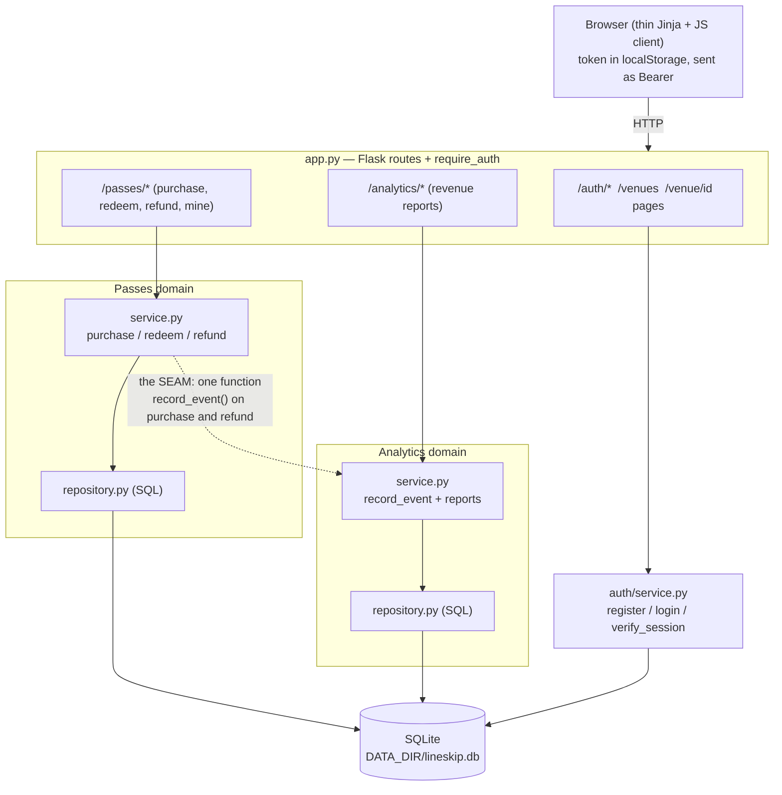
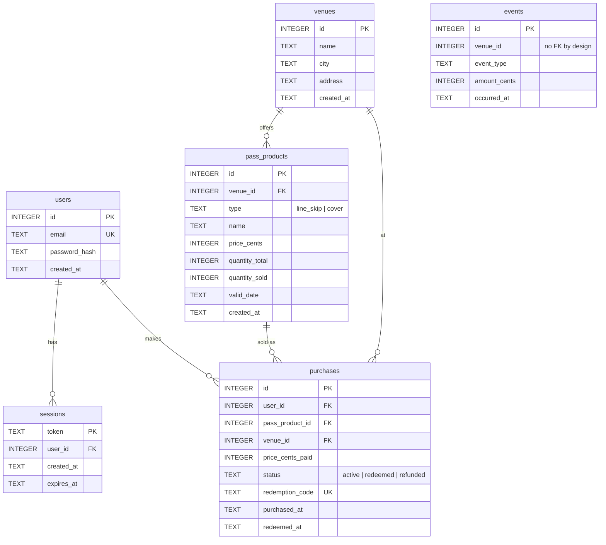

# LineSkip — Project Report

**Author:** Amit Mayer
**Course:** DevOps — Individual Assignment 1
**Repository:** a single-process Flask + SQLite monolith, built to satisfy the §7 deployment
contract so it can be Dockerized and deployed in Assignment 2.

---

## 1. How the idea was formed

As I was thinking about what to build, I wanted to make something that was actually useful and could
be a real product, not an academic toy. My roommate recently went on a trip to the US, where the
very crowded bars and clubs use an app for a "fast pass" that works in collaboration with the
venues: you buy a pass in advance and skip the line at the door. What struck me is that this is
essentially an added stream of revenue for the clubs with almost no risk to them — they are selling
access they already control, and the app handles the money and the redemption.

Looking at the project deliverables, I realized this idea aligned very well with the scope of the
assignment: it needs real persistence, it splits naturally into two genuinely distinct backend
domains, and it has enough substance to justify real design decisions. So I went through with it and
built **LineSkip** — a Madrid take on that model (inspired by [LineLeap](https://www.lineleap.com/)):
users buy line-skip or cover passes for nightlife venues and redeem them at the door.

**Invented stakeholder / scale (to justify design choices):** the customer is a Madrid nightlife
operator running several venues, expecting on the order of ~10,000 users with demand spiking on
weekend nights. That spike is why inventory correctness under concurrency (no overselling a limited
number of passes) is a first-class concern rather than an afterthought.

### The two feature domains

- **Passes** — venues, pass products (line-skip / cover), purchasing with a no-oversell inventory
  guard, one-time redemption codes, and refunds. This is the transactional core.
- **Analytics** — records a sales event on each purchase into its **own** `events` table and reports
  revenue (total, per-venue, top venues, per-day). It reads only its own table.

The two are coupled through a single integration point — the `record_event()` function (the "seam",
see §3 and ADR-2) — so they could later be split into separate services.

---

## 2. SDLC model and SMART goals

### Model chosen: incremental & iterative

I followed an **incremental, iterative** SDLC rather than a big-design-up-front (waterfall) model.
The project was built as a sequence of small vertical slices — scaffold → authentication → passes
schema → purchasing → redeem/refund → analytics seam → analytics reporting → frontend → tests/docs —
where each slice was designed, explained in plain language, approved, built, tested, and only then
committed.

**Why this fits this project specifically:**
- The assignment is graded heavily on *process evidence over time* (the ADR and AI-usage logs, and a
  commit history spanning ≥6 days). An incremental model produces that evidence naturally, because
  each decision is recorded the day it is actually made.
- The grade is multiplied by a closed-book oral check where I must explain my own code. Building one
  small, fully-understood slice at a time is the approach most likely to leave me able to explain
  every line, which a waterfall "build it all then integrate" approach would not.
- The requirements were stable and known up front (the spec), so the *iterative* part was less about
  changing requirements and more about refining each slice (e.g. hardening auth with edge-case tests
  after the happy path worked).

### SMART goals

| Goal | Specific / Measurable | Achievable | Relevant | Time-bound | Outcome |
|---|---|---|---|---|---|
| Two decoupled domains with one documented seam | Passes + Analytics joined by a single `record_event()` call; no FK between them | Yes, in-process call | Core §3 requirement | By Day 3 | **Met** (ADR-2) |
| ≥70% test coverage on core logic | `pytest --cov` on `auth`/`passes`/`analytics` | Yes | §4 requirement | By Day 5 | **Exceeded — 100%** |
| Satisfy the §7 deployment contract | Starts with `python app.py`, binds `0.0.0.0`, reads `PORT`/`DATA_DIR`, auto-creates schema, no prompts | Yes | Enables Assignment 2 | By Day 1, held throughout | **Met** |
| Real process evidence | 5 ADRs across ≥3 dates; one AI-usage row per interaction; 12+ commits over 6+ days | Yes | §5, largest grade share | By Day 6 | **Met** |

### How I did (and didn't) follow it

I followed the incremental model closely: every segment went through the
design→approve→build→test→commit loop, and ADR entries were written on the day the decision was made
(ADR-1 on Day 1, ADR-2/3 on Day 2–3, ADR-4 on Day 5, ADR-5 on Day 6), which is why the log spans
multiple real dates rather than being backfilled at the end. Where I deviated: I occasionally
front-loaded a design decision before its code (e.g. deciding the no-FK `events` table on Day 3 even
though reporting wasn't built until Day 4), because committing to the seam early kept the two domains
from accidentally entangling. I also deferred all UI work to one later slice rather than building a
little frontend per domain, since the graded logic lives in the service modules and I wanted those
locked and tested first.

---

## 3. Architecture overview

LineSkip runs as **one Flask process**. `app.py` is the entrypoint and the only place Flask lives;
it wires routes to two independent service layers, each backed by a repository (SQL-only) module,
all persisting to a single SQLite file. Business logic lives in the service/repository layers (pure
Python, no Flask), which is what makes it unit-testable and explainable.



**Request walk-through (buying a pass):** the browser POSTs to `/passes/purchase` with its Bearer
token. `require_auth` resolves the token to a `user_id`. `passes.service.purchase()` loads the
product, atomically claims one unit of inventory (`try_claim_unit`), inserts the purchase with a
unique redemption code, commits, and then calls
`analytics.record_event(venue_id, "purchase", price_cents)`. The same function is the only way
either domain talks to the other — `refund()` also calls it to record a `refund` event — so that
one function (the dotted arrow) is the single coupling point that would become a network/queue
message if Analytics were split into its own service later.

---

## 4. Database schema

All six tables live in one SQLite database created from `schema.sql` at startup. Money is stored as
integer cents everywhere (never floats). The Analytics `events` table deliberately has **no foreign
key** into the Passes tables — it keeps its own copy of what it needs — which is what lets the two
domains be separated later (ADR-2, ADR-3).



**Design notes (match ADR-3):** inventory is a `quantity_total` / `quantity_sold` pair so the
oversell guard is a trivial `quantity_sold < quantity_total` check inside one atomic `UPDATE`.
`purchases` carries a denormalized `venue_id` and a `status` enum so a purchase can be reported and
state-transitioned without joining back through `pass_products`. `events` stands alone with no
relationship line into the Passes tables — that gap is intentional and is the architectural seam.

---

## 5. Testing & setup

Automated tests cover the core business logic of both domains plus auth, run against a fresh
temporary SQLite database per test. Coverage is measured with `pytest-cov`:

```bash
pytest --cov=auth --cov=passes --cov=analytics --cov-report=term-missing
```

Latest result: **34 tests pass, 100% line coverage** on the measured modules (full table in the
README). Coverage targets the service/repository layers rather than the thin Flask routes, because
that is where the logic I have to explain actually lives (ADR-4).

Full setup instructions — virtualenv, install, run, environment variables, and the deployment
contract — are in `README.md`. In short: `pip install -r requirements.txt` then `python app.py`, and
the app is ready on `PORT` (default 8000) within a couple of seconds, writing its database to
`${DATA_DIR}/lineskip.db`.

---

## 6. AI-disclosure statement

I, Amit Mayer, acknowledge the use of **Claude Code (Anthropic)** to act as a design-and-pair-
programming partner while building LineSkip. The prompts used include asking it to propose and
scaffold the Flask + SQLite skeleton, to implement session-token authentication, to build the Passes
domain (schema, purchasing with an atomic oversell guard, redeem and refund), to create the Analytics
domain and its single-call seam and revenue reports, to build a thin Jinja/JS frontend over the JSON
API, to write edge-case unit tests toward the coverage target, and to help draft the ADR entries,
this report, and the documentation. The full prompt-by-prompt record is in `AI_USAGE.md`.

The output of these prompts was used to produce the code and documentation in this repository, but
**every segment was designed, reviewed, questioned, and approved by me before it was written**, I
made the design decisions as we went (stack, the two-domain split, the no-FK seam, the auth model,
and what to deliberately leave out), and I ran and tested each segment myself before committing it.
The detailed, per-interaction log — including, in my own words, how each accepted piece of code
works — is maintained in `AI_USAGE.md` as required by §5.
